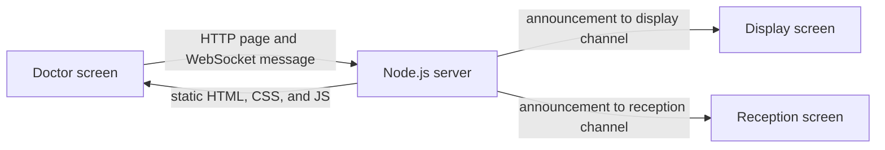

# Project story and technical overview

## Why this exists

CareCall Appointment Notifier is a small calling system for a clinic or service desk. Staff enter a number on the Doctor screen and choose whether it should appear on the Display screen or the Reception screen. The receiving screen announces the number, speaks it aloud in the browser, and shows how long ago it arrived.

The application handles calling and displaying numbers only. It does not create appointments, maintain patient records, or save a history of calls.

## What happens when a number is sent

1. A browser loads `/doctor`, `/display`, or `/reception` from the Node.js server.
2. Each screen opens a WebSocket connection to `/ws` on the same host and port.
3. The Doctor screen sends a small JSON message with a target channel (`display` or `reception`) and the number.
4. The server broadcasts the announcement to connected screens in that channel. It keeps the connected screens in in-memory sets, so restarting the server clears those connections and there is no call history to restore.
5. The receiving browser updates its page, speaks the number using browser speech synthesis, and starts its elapsed-time display.

## Technical choices

- **Node.js built-in `http`:** serves the static files and handles the WebSocket upgrade on one port. Express is not used.
- **`ws`:** the only runtime dependency. It implements the WebSocket server and keeps a live connection open so announcements can be pushed immediately.
- **Plain browser code:** HTML and CSS define the screens; JavaScript sends and receives messages. Speech comes from the browser's built-in speech synthesis.
- **In-memory channel sets:** the server tracks currently connected display and reception screens. There is no database, login, persistence, or audit log.
- **npm:** installs the dependency and runs the app. This code is an application rather than a reusable npm library, and `package.json` marks it private to prevent accidental publication.

## Current limits

The `role` value in a WebSocket URL only selects a screen channel; it is not authentication. The server uses plain HTTP/WebSocket without TLS and has no access control. Binding to a specific address limits the network interface that accepts traffic, but it does not protect the app from other clients that can reach that address. Keep it on a trusted network until authentication and HTTPS/WSS are added.
