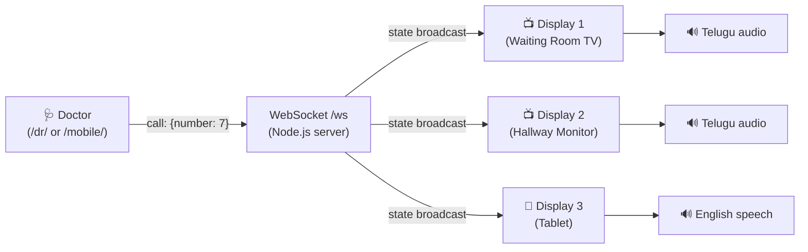

# CareCall — System Overview

## Why This Exists

CareCall is a small, plug-and-play calling system for a clinic, hospital, or service desk. A doctor or staff member taps a token number on any Doctor screen (desktop console or mobile keypad). Every connected Waiting Display instantly shows that number, announces it in Telugu and English, and starts an elapsed-time counter.

The system handles **calling and displaying token numbers only**. It does not create appointments, maintain patient records, or save a history of calls.

---

## Screens & Roles

| Screen | URL | Role |
|---|---|---|
| Home Gateway | `/` | Navigation launcher (no WebSocket) |
| Waiting Display | `/display/` | Passive receiver — shows token, speaks audio |
| Doctor Console | `/dr/` | Sender — desktop keypad |
| Doctor Mobile V-1 | `/mobile/v1/` | Sender — original mobile keypad |
| Doctor Mobile V-2 | `/mobile/v2/` | Sender — compact (no header band) |
| Doctor Mobile V-3 | `/mobile/v3/` | Sender — status row + live card + bottom nav |

---

## What Happens When a Number Is Sent

1. A browser opens any screen from the Node.js server (e.g. `/dr/`, `/display/`).
2. Each screen opens a WebSocket connection to `/ws` on the same host and port.
3. A Doctor screen sends `{ "type": "call", "number": "7" }` over that WebSocket.
4. The server stores the call in memory and **broadcasts the new state to every connected client** simultaneously — no role filtering, no channel separation.
5. Every receiving browser (Display screens and other Doctors) updates its UI, speaks the number using Telugu audio clips + Web Speech API, and starts the elapsed-time display.



---

## Technical Choices

- **Node.js built-in `http`** — serves static files and handles WebSocket upgrade on one port. No Express, no framework.
- **`ws` library** — the only runtime WebSocket dependency. Keeps persistent connections so announcements are pushed instantly.
- **`sirv`** — lightweight static file server for the `public/` folder.
- **Plain browser code** — HTML, CSS, and vanilla JavaScript. No build step, no bundler.
- **Telugu audio clips** — `.wav` and `.mp3` files in `public/audio/te/` for numbers 1–30+. Numbers 1–10 say "నంబర్ [word]".
- **Web Speech API** — English browser speech synthesis for numbers beyond the Telugu clip range.
- **In-memory state** — `ws/state.js` holds `{ number, sentAt }` for the current call. No database, no login, no audit log.

---

## Server Code Layout

```
app.js                        Entry point: HTTP server + WebSocket + listen
ws/
  attachWebSocketServer.js    Mounts WSS on /ws, starts 25-second heartbeat
  handleConnection.js         Routes ws events to handlers
  handlers/
    onConnect/index.js        Sends current state snapshot; notifies presence
    onMessage/handleCall.js   Saves call; broadcasts to all clients
    onClose/index.js          Notifies presence on disconnect
  broadcast.js                JSON send loop over wss.clients
  state.js                    setCurrentCall / getCurrentCall
  heartbeat.js                ping/pong every 25 s to keep TV connections alive
public/
  index.html                  Home gateway
  display/                    Waiting area display screen
  dr/                         Doctor console (desktop)
  mobile/v1/ v2/ v3/          Doctor mobile keypad versions
  audio/te/                   Telugu WAV/MP3 clips
```

---

## Browser Audio Policy

Modern browsers block audio until the user interacts with the page. CareCall handles this with:
1. A global `click / touchstart / keydown` listener that marks audio as unlocked.
2. A 🔊 **Voice** toggle button on the Display screen for explicit unlock.
3. Error-handling callbacks that show a "Tap screen to enable audio" instruction.

---

## Current Limits

- No authentication — the WebSocket role parameter selects behaviour only, not security.
- No TLS — plain HTTP/WS. Run on a trusted LAN or behind a reverse proxy (Caddy) for HTTPS.
- No persistence — restarting the server clears the current token.
- See **[VPS Publishing Runbook](publish-to-vps.html)** for a full Caddy + Linux deployment guide.
