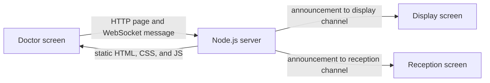

# Project story and technical overview

## Why this exists

CareCall Appointment Notifier is a small calling system for a clinic or service desk. Staff enter a number on the Doctor screen and choose whether it should appear on the Display screen or the Reception screen. The receiving screen announces the number, speaks it aloud in the browser, and shows how long ago it arrived.

The application handles calling and displaying numbers only. It does not create appointments, maintain patient records, or save a history of calls.

## What happens when a number is sent

1. A browser loads `/doctor`, `/display`, or `/reception` from the Node.js server.
2. Each screen opens a WebSocket connection to `/ws` on the same host and port.
3. The Doctor screen sends a small JSON message with a target channel (`display` or `reception`) and the number.
4. The server broadcasts the announcement to connected screens in that channel. It keeps the connected screens in in-memory sets, so restarting the server clears those connections and there is no call history to restore.
5. The receiving browser updates its page, speaks the number using browser speech synthesis, and starts its elapsed-time display.

## Technical choices

- **Node.js built-in `http`:** serves the static files and handles the WebSocket upgrade on one port. Express is not used.
- **`ws`:** the only runtime dependency. It implements the WebSocket server and keeps a live connection open so announcements can be pushed immediately.
- **Plain browser code:** HTML and CSS define the screens; JavaScript sends and receives messages. English speech uses the browser's built-in speech synthesis. V4 Telugu speech plays WAV files served locally from `public/v4/audio/te/`.
- **In-memory channel sets:** the server tracks currently connected display and reception screens. There is no database, login, persistence, or audit log.
- **npm:** installs the dependency and runs the app. This code is an application rather than a reusable npm library, and `package.json` marks it private to prevent accidental publication.

## Server code layout

The server is split by responsibility so the startup path reads in order:

1. **app.js** loads the port configuration, creates the HTTP server, attaches the WebSocket endpoint, and starts listening.
2. **server/config.js** reads an optional .env port and validates the final port setting.
3. **server/http/createHttpServer.js** creates the HTTP server; **pageRoutes.js** maps friendly URLs to versioned pages, and **serveStaticFile.js** serves pages and browser assets from public/.
4. **ws/attachWebSocketServer.js** accepts the /ws upgrade and directs each connection to the matching handler. **handleConnection.js** and **handleV3Connection.js** contain the messaging behavior for the existing flows.
5. **server/startServer.js** binds the configured port and prints the local entry points.

This keeps the entry file focused on how the pieces fit together while the modules explain what each part does.

## Frontend versions

The browser screens are kept in `public/v1/`, `public/v2/`, `public/v3/`, and `public/v4/`. V1 preserves the earlier layout. V2 keeps the Display and Reception flow and is still served by the standard `/doctor`, `/display`, and `/reception` routes. V3 is a focused Doctor-and-Display flow at `/v3/doctor` and `/v3/display`. V4 carries that flow forward at `/v4/doctor` and `/v4/display`, adds a persistent voice toggle, speaks English through browser speech synthesis, and plays Telugu WAV clips for numbers 1–10. The files are `public/v4/audio/te/01.wav` through `10.wav`; Telugu playback reports that clips above 10 are unavailable. V3 and V4 each keep one current announcement in separate server memory state, so a newer Display connection replaces the previous one only within its version.

The Telugu clips say “నంబర్” followed by each number word, from one through ten. They were generated with TTSForge's Aishwarya Telugu (India) voice; its [terms of service](https://ttsforge.com/terms/) describe usage rights for generated audio. Listen to the clips on the intended speakers and confirm pronunciation before using them with patients.

## Current limits

The `role` value in a WebSocket URL only selects a screen channel; it does not authenticate users. The server listens on all network interfaces and uses plain HTTP/WebSocket without TLS or access control. Keep it on a trusted network, and use firewall rules to limit access. For a VPS, put it behind a reverse proxy with HTTPS/WSS until authentication is added.
