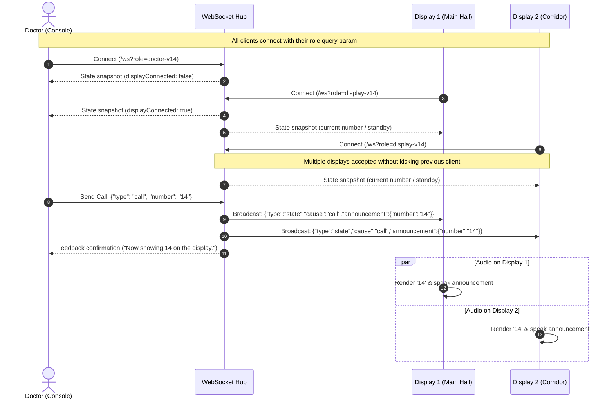

# Project Story: V14 Multi-Display Simultaneous Audio & Architecture

## Overview & Purpose

In a clinic, hospital, or service center, queue numbers often need to be visible and audible in multiple locations at once—such as the main waiting hall, corridor monitors, sub-waiting rooms, and reception desks. 

**CareCall V14** redesigns the real-time notification layer to support unlimited concurrent display screens, all synchronized to the Doctor Console with instantaneous number updates and bilingual voice announcements.

---

## Architecture Diagram

```mermaid
flowchart TD
    Doctor["Doctor Console\n/v14/doctor\n(Role: doctor-v14)"]
    
    subgraph Server["CareCall Server (:3000)"]
        HTTP["HTTP Static Server\n(sirv / node:http)"]
        WS["WebSocket Server\n/ws?role=..."]
        State["Shared V14 Live State\n• announcement: { number, sentAt }\n• doctors: Set()\n• displays: Set()"]
        Heartbeat["25s Heartbeat Ping/Pong"]
    end
    
    subgraph Displays["Concurrent Display Screens"]
        D1["Display 1: Waiting Room TV\n/v14/display\n(Role: display-v14)"]
        D2["Display 2: Hallway Screen\n/v14/display\n(Role: display-v14)"]
        D3["Display 3: Mobile / Tablet\n/v14/display\n(Role: display-v14)"]
    end

    Doctor -->|1. Keypad Call (number: '4')| WS
    WS --> State
    State --> Heartbeat
    State -->|2. Broadcast Snapshot & Call| D1
    State -->|2. Broadcast Snapshot & Call| D2
    State -->|2. Broadcast Snapshot & Call| D3
    
    D1 -->|3. Audio: 'Number 4'| Audio1["Speaker 1"]
    D2 -->|3. Audio: 'Number 4'| Audio2["Speaker 2"]
    D3 -->|3. Audio: 'Number 4'| Audio3["Speaker 3"]
```

---

## Sequence of a Multi-Display Call



---

## Problems Solved in This Story

### 1. Close Code 1008 ("Unknown role") on V14 Rollout
- **Cause**: The server's role mapping map (`versionedRoles`) was hardcoded up to `v12`. When `/v14/doctor` connected with `role=doctor-v14`, it fell through to legacy role validation and was terminated with WebSocket code `1008`.
- **Solution**: Updated [ws/attachWebSocketServer.js](file:///d:/KeshavSoft/nov/11-1/appointment-notifier/ws/attachWebSocketServer.js) with regex-based role resolution:
  ```javascript
  const match = requestedRole.match(/^(doctor|display)-(v\d+)$/);
  if (match) {
      const roleConfig = {
          role: `${match[1] === "display" ? "display" : "doctor"}-v3`,
          state: sharedState
      };
      versionedRoles.set(requestedRole, roleConfig);
      return roleConfig;
  }
  ```
  Any current or future version (`v14`, `v15`, etc.) connects automatically without code changes.

---

### 2. Close Code 4001 ("A newer display connected")
- **Cause**: Earlier backend logic assumed a 1:1 doctor-to-display topology. If Display 2 connected while Display 1 was active, the server called `previous.close(4001, "A newer display connected")`. Both displays would then enter an aggressive reconnection loop, knocking each other offline.
- **Solution**: Changed state in [ws/handleV3Connection.js](file:///d:/KeshavSoft/nov/11-1/appointment-notifier/ws/handleV3Connection.js) from `display: null` to a set:
  ```javascript
  export function createV3State() {
      return {
          announcement: null,
          doctors: new Set(),
          displays: new Set()
      };
  }
  ```
  Removed the termination logic entirely. `broadcastState` now iterates over `state.displays` and sends the call event to every active client.

---

### 3. Browser Audio Autoplay Policy & Unlocking
- **Cause**: Modern web browsers (Chrome, Firefox, Safari, Edge) block audio elements and speech synthesis until the user interacts with the page (click/tap). In `display.js`, a strict check `if (!audioUnlocked) return;` prevented any speech from firing unless the user had clicked a specific "Test voice" button.
- **Solution**:
  1. Added global window listeners for `click`, `touchstart`, and `keydown` so touching or clicking anywhere on the screen unlocks audio.
  2. Removed the blocking guard in `announce()`.
  3. Added error-handling callbacks that instruct the user to tap the screen if the browser's autoplay policy intercepts speech.

---

## Diagnostics & Git Hygiene

- **Structured Logging**: All WebSocket connections, disconnections, call arrivals, and errors are appended to `logs/log.txt` as single-line JSON entries.
- **Git Ignoring Logs**: Because `logs/log.txt` contains machine-specific runtime state, it has been untracked from Git and excluded via `.gitignore`:
  ```gitignore
  logs/
  *.log
  ```
  This keeps commits and PRs clean while preserving diagnostic logs on disk for debugging.

---

## Quick Verification Checklist

1. **Start Server**: `npm run start`
2. **Open Doctor**: Visit `http://localhost:3000/v14/doctor` (Status shows **Server connected**).
3. **Open Display 1**: Visit `http://localhost:3000/v14/display` in Chrome.
4. **Open Display 2**: Visit `http://localhost:3000/v14/display` in Firefox or on another device.
5. **Activate Audio**: Click once anywhere on each display screen (confirm **Voice on** is illuminated).
6. **Trigger Call**: Enter a number (e.g. `12`) on the Doctor Console and tap **Send to display**.
7. **Verify**: Both screens update to `12` simultaneously and play the announcement sound.

